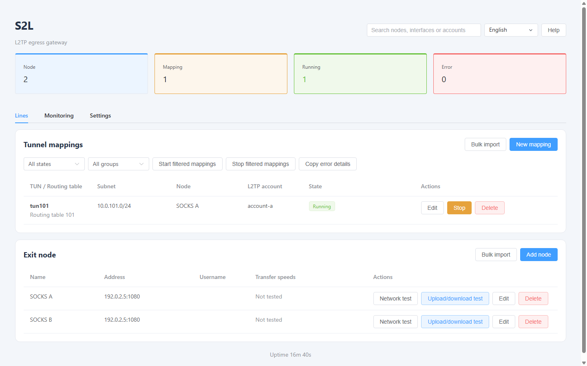

# S2L

[English](README.md) · [繁體中文](README.zh-Hant.md) · [简体中文](README.zh-Hans.md)

**Web-managed L2TP gateway for Linux with fixed SOCKS5 exits, per-mapping bandwidth limits and automatic outage diagnostics.**

[](https://github.com/lucaswren/s2l/actions/workflows/ci.yml) · [Latest release](https://github.com/lucaswren/s2l/releases/latest) · [Questions](https://github.com/lucaswren/s2l/discussions) · [Contributing](CONTRIBUTING.md) · [Apache-2.0](LICENSE)



Actual interface rendered from isolated test fixtures; the addresses and accounts are examples. [Mapping and bandwidth settings](docs/assets/showcase-mapping.png) · [Automatic outage evidence](docs/assets/showcase-evidence.png) · [Monitoring](docs/assets/showcase-monitoring.png)

- Give each dialing device its own mapping and fixed SOCKS5 exit; one PPP session per account.
- Set upload/download limits per mapping; keep DNS failover on that same exit.
- Save bounded fault status, logs and IPv4 packet headers before restarting a mapping.

S2L runs on a dedicated Linux server. A Go backend and embedded Vue / Element Plus interface manage sing-box, L2TP/PPP and Linux policy routing. Each mapping uses an explicitly selected SOCKS5 or Local WAN egress; a SOCKS5 failure never falls back to WAN. Diagnostics distinguish local forwarding, upstream and DNS failures.

Three tabs keep daily operation separate: **Lines**, **Monitoring** and **Settings**. [Monitoring](docs/en/operations.md#runtime-monitoring) shows PPP upload/download rates, new and cumulative errors, sample freshness and recent events.

## Requirements and limits

| Item | Scope |
|---|---|
| Host | Dedicated Ubuntu/Debian with systemd, root, reachable public IPv4 and TUN/PPP/L2TP kernel support |
| Validation | Ubuntu 24.04 and Debian 12 amd64 fresh-install VM tests; arm64 cross-build checks |
| Upstream | Authorized SOCKS5 service with working TCP CONNECT and access to application and DoH/TCP DNS destinations |
| Client traffic | IPv4; one PPP session per account; non-DNS UDP rejected; PPP IPv6 blocked |
| Languages | English, Traditional Chinese and Simplified Chinese |

**Plain L2TP is unencrypted and is the default.** Optional L2TP/IPsec uses IKEv1 with a shared PSK; verify client compatibility. Management HTTPS and SOCKS5 do not encrypt the complete tunnel path. Use only authorized systems and services; read the [client requirements](docs/en/clients.md) and [legal notes](docs/en/legal.md) before deployment. Client routing and other network adapters remain outside the server's protection.

## Installation

**Install S2L 1.0.6 on a clean, dedicated server.**

Review the scripts before running them as root. Installation changes packages, forwarding, PPP/L2TP, firewall rules and services; use a new, dedicated host and apply security updates in maintenance windows. New installs default to [manual APT maintenance](docs/en/operations.md#system-update-policy). The installer selects the latest stable release by default.

```bash
curl -fsSL https://raw.githubusercontent.com/lucaswren/s2l/main/script/remote_install.sh | sudo bash -s -- --lang en
```

Restrict the printed HTTPS TCP port to trusted administrator IPs. The installer generates a self-signed certificate and random admin password; verify its printed SHA-256 fingerprint through a trusted channel before trusting it. The backend stays on `127.0.0.1:8080`. For a fixed management port, replace `sudo bash` with `sudo env HTTPS_PORT=8443 bash`; otherwise an unused port in 10000–60000 is selected. Use `PUBLIC_IP` if public IPv4 detection needs an override.

Open the printed URL, add a SOCKS5 node, create and start a mapping, then follow [client setup and acceptance checks](docs/en/clients.md). Plain L2TP uses UDP 1701; IPsec uses UDP 500/4500 with enforced NAT-T. Installation options, firewall ownership and recovery are in the [operations guide](docs/en/operations.md).

## Upgrade

For installations created by the current installer, run during a maintenance window:

```bash
curl -fsSL https://raw.githubusercontent.com/lucaswren/s2l/main/script/remote_update.sh | sudo bash
```

The updater selects the latest stable release and pins its commit. It runs in the background; SSH disconnection does not cancel it. Check `/var/lib/s2l/cli-update/update.log` and `result.json` for progress and completion. To choose a reviewed tag or commit, replace `sudo bash` with `sudo env S2L_REF=YOUR_REVIEWED_REF bash`. It builds first, backs up the deployment and preserves settings; running clients must reconnect. Read [upgrade and recovery](docs/en/operations.md#upgrade) before updating. Do not rerun the installer to upgrade.

## Documentation

| Topic | English | 繁體中文 | 简体中文 |
|---|---|---|---|
| Client setup, DNS and acceptance | [Guide](docs/en/clients.md) | [指南](docs/zh-Hant/clients.md) | [指南](docs/zh-Hans/clients.md) |
| Operation, diagnostics, backups and uninstall | [Guide](docs/en/operations.md) | [指南](docs/zh-Hant/operations.md) | [指南](docs/zh-Hans/operations.md) |
| Architecture, configuration and development | [Guide](docs/en/development.md) | [指南](docs/zh-Hant/development.md) | [指南](docs/zh-Hans/development.md) |
| Legal and compliance | [Notes](docs/en/legal.md) | [說明](docs/zh-Hant/legal.md) | [说明](docs/zh-Hans/legal.md) |

Automatic outage evidence is enabled under **Settings → Backup and troubleshooting**. Export the saved report before restarting a failed mapping; if automatic checks missed the problem, choose **Capture current evidence**. See [collection limits](docs/en/operations.md#automatic-outage-evidence). Debug is a separate, temporary recording mode.

Use [Discussions](https://github.com/lucaswren/s2l/discussions) for setup questions and [Issues](https://github.com/lucaswren/s2l/issues/new/choose) for reproducible bugs. [Contributing](CONTRIBUTING.md) covers development checks; the [short introduction](docs/introduction.md) provides text for sharing.

## Acknowledgements

Thank you to the maintainers and contributors of the open-source projects that make S2L possible:

- Tunnel and forwarding: [sing-box](https://github.com/SagerNet/sing-box), [xl2tpd](https://github.com/xelerance/xl2tpd), [PPP](https://github.com/ppp-project/ppp) and [strongSwan](https://www.strongswan.org/).
- Interface and build tools: [Vue](https://vuejs.org/), [Element Plus](https://element-plus.org/), [Vite](https://vite.dev/), [Go](https://go.dev/) and [Python](https://www.python.org/).
- System and diagnostics: [Linux](https://www.kernel.org/), [Netfilter](https://www.netfilter.org/), [iproute2](https://wiki.linuxfoundation.org/networking/iproute2), [tcpdump](https://www.tcpdump.org/), [systemd](https://systemd.io/), [Nginx](https://nginx.org/) and [OpenSSL](https://openssl-library.org/).

See [third-party notices](THIRD_PARTY_NOTICES.md) for component relationships and license references, and [frontend license texts](web/THIRD_PARTY_LICENSES.txt) for frontend dependencies. These acknowledgements do not imply upstream endorsement or affiliation.

## Security and licensing

Restrict management access, use HTTPS and protect credentials/backups. Keep a recovery SSH session during access changes. Never post configuration, state, PSKs or passwords in public issues. See [security reporting](SECURITY.md).

Original S2L code and documentation are licensed under [Apache-2.0](LICENSE). See [NOTICE](NOTICE) and [third-party notices](THIRD_PARTY_NOTICES.md); dependencies retain their own licenses. A software license does not grant regulatory approval. See the legal notes.
