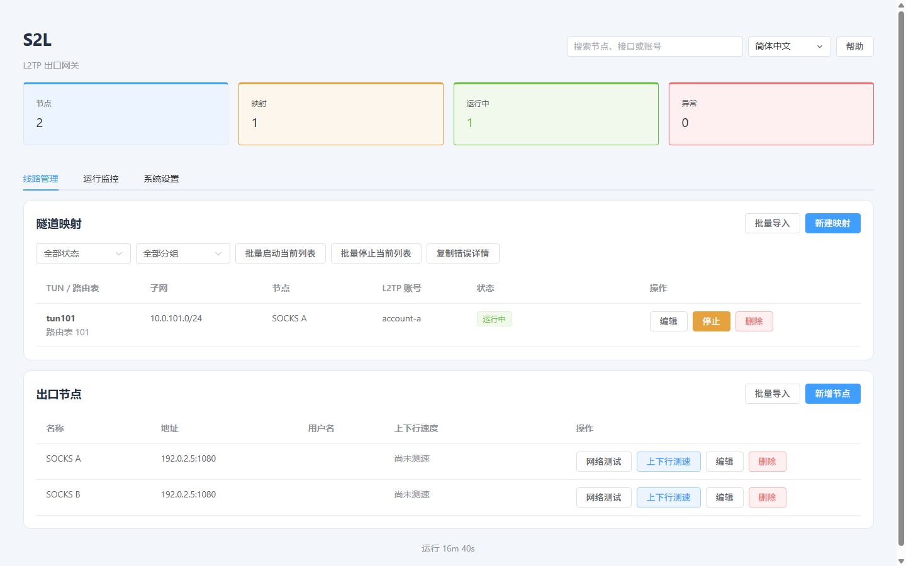

# S2L

[English](README.md) · [繁體中文](README.zh-Hant.md) · [简体中文](README.zh-Hans.md)

**支持网页管理的 Linux L2TP 网关，提供固定 SOCKS5 出口、按映射限速和故障自动诊断。**

[](https://github.com/lucaswren/s2l/actions/workflows/ci.yml) · [最新版本](https://github.com/lucaswren/s2l/releases/latest) · [使用讨论](https://github.com/lucaswren/s2l/discussions) · [参与贡献](CONTRIBUTING.md) · [Apache-2.0](LICENSE)



截图来自隔离测试中的真实界面，地址与账号均为示例。[映射与带宽设置](docs/assets/zh-Hans/showcase-mapping.png) · [断网自动取证](docs/assets/zh-Hans/showcase-evidence.png) · [运行监控](docs/assets/zh-Hans/showcase-monitoring.png)

- 每台拨号设备使用独立映射及固定 SOCKS5 出口，一个账号对应一条 PPP 会话。
- 按映射设置上传、下载上限，DNS 备用查询保持同一出口。
- 出现异常先保留状态、日志和 IPv4 报文头，减少重启映射后丢失现场。

S2L 在专用 Linux 主机上运行，由 Go 后端与内嵌 Vue / Element Plus 界面管理 sing-box、L2TP/PPP 和策略路由。每条映射明确选择 SOCKS5 或本机 WAN 出口，SOCKS5 故障不会回落到 WAN。诊断区分本地转发、上游和 DNS 故障。

界面分为 **线路管理、运行监控、系统设置** 三个标签页。[运行监控](docs/zh-Hans/operations.md#运行监控) 显示 PPP 上下行速率、新增与累计错误、采样时效及最近事件。

## 环境与限制

| 项目 | 范围 |
|---|---|
| 主机 | 专用 Ubuntu/Debian、systemd、root、可达的公网 IPv4，以及内核 TUN/PPP/L2TP 支持 |
| 验证 | Ubuntu 24.04、Debian 12 amd64 全新安装虚拟机测试；arm64 交叉构建检查 |
| 上游 | 授权 SOCKS5 服务，TCP CONNECT 正常，可访问应用和 DoH/TCP DNS 目标 |
| 客户端流量 | IPv4；每账号一条 PPP 会话；拒绝非 DNS UDP；阻断 PPP IPv6 |
| 语言 | 英语、繁体中文、简体中文 |

**默认普通 L2TP 不加密。** 可选 L2TP/IPsec 使用 IKEv1 与共享 PSK，须验证客户端兼容性；管理 HTTPS 和 SOCKS5 不会加密整条隧道路径。仅用于授权主机和服务，部署前阅读[接入要求](docs/zh-Hans/clients.md)及[法律说明](docs/zh-Hans/legal.md)。客户端路由和其他网络接口不在服务器保护范围内。

## 安装与安全

**请在干净的专用服务器上全新安装 S2L 1.0.5。**

以 root 执行前先审阅脚本。安装会修改软件包、转发、PPP/L2TP、防火墙和服务，请使用全新专用主机并在维护窗口安装安全更新。新安装默认采用[人工 APT 维护](docs/zh-Hans/operations.md#系统更新策略)。安装程序默认获取最新稳定版。

```bash
curl -fsSL https://raw.githubusercontent.com/lucaswren/s2l/main/script/remote_install.sh | sudo bash -s -- --lang zh-Hans
```

仅允许可信管理 IP 访问输出的 HTTPS TCP 端口。安装会生成自签证书和随机管理密码，信任前须通过可信渠道核对输出的 SHA-256 指纹。后端保持监听 `127.0.0.1:8080`。如需固定管理端口，将 `sudo bash` 改成 `sudo env HTTPS_PORT=8443 bash`；默认从 10000–60000 选择空闲端口。公网 IPv4 检测需覆盖时使用 `PUBLIC_IP`。

打开输出的网址，添加 SOCKS5 节点、创建并启动映射，再按[客户端接入与验收](docs/zh-Hans/clients.md)完成连接。普通 L2TP 使用 UDP 1701；IPsec 强制 NAT-T，使用 UDP 500/4500。安装选项、防火墙范围和恢复流程见[操作指南](docs/zh-Hans/operations.md)。

## 升级

通过当前安装器部署后，在维护窗口执行：

```bash
curl -fsSL https://raw.githubusercontent.com/lucaswren/s2l/main/script/remote_update.sh | sudo bash
```

升级默认选择最新稳定版并固定提交，在后台执行，SSH 断开不会中止任务。进度与结果见 `/var/lib/s2l/cli-update/update.log` 和 `result.json`。若要指定已审阅标签或提交，将 `sudo bash` 改成 `sudo env S2L_REF=YOUR_REVIEWED_REF bash`。脚本先构建、备份并保留配置；运行中的客户端须重新连接。操作前阅读[升级与恢复](docs/zh-Hans/operations.md#更新-s2l-应用)，不要重跑安装程序升级。

## 文档

- [客户端接入、DNS 与验收](docs/zh-Hans/clients.md)
- [操作、诊断、备份与卸载](docs/zh-Hans/operations.md)
- [架构、配置与开发](docs/zh-Hans/development.md)
- [法律与合规](docs/zh-Hans/legal.md)
- [安全问题报告（英文）](SECURITY.md)

故障自动取证默认开启，入口为 **系统设置 → 备份与排障**。故障时先导出现场再重启映射；自动检查未发现问题时，可选择映射并点击“记录当前现场”。[取证限制](docs/zh-Hans/operations.md#故障自动取证)见操作指南；临时 Debug 为独立功能。

安装疑问使用 [Discussions](https://github.com/lucaswren/s2l/discussions)，可复现问题使用 [Issues](https://github.com/lucaswren/s2l/issues/new/choose)。开发检查见[贡献指南](CONTRIBUTING.md)，分享文案见[简短介绍](docs/introduction.md#简体中文)。

## 致谢

感谢以下开源项目的维护者与贡献者，让 S2L 得以实现：

- 隧道与转发：[sing-box](https://github.com/SagerNet/sing-box)、[xl2tpd](https://github.com/xelerance/xl2tpd)、[PPP](https://github.com/ppp-project/ppp)、[strongSwan](https://www.strongswan.org/)。
- 界面与构建工具：[Vue](https://vuejs.org/)、[Element Plus](https://element-plus.org/)、[Vite](https://vite.dev/)、[Go](https://go.dev/)、[Python](https://www.python.org/)。
- 系统与诊断：[Linux](https://www.kernel.org/)、[Netfilter](https://www.netfilter.org/)、[iproute2](https://wiki.linuxfoundation.org/networking/iproute2)、[tcpdump](https://www.tcpdump.org/)、[systemd](https://systemd.io/)、[Nginx](https://nginx.org/)、[OpenSSL](https://openssl-library.org/)。

组件使用方式与许可参考见[第三方声明](THIRD_PARTY_NOTICES.md)，前端依赖的许可原文见[前端许可清单](web/THIRD_PARTY_LICENSES.txt)。致谢不代表上游项目背书或与 S2L 存在关联。

## 许可

S2L 原创代码与文档采用 [Apache-2.0](LICENSE)。参阅 [NOTICE](NOTICE) 与[第三方声明](THIRD_PARTY_NOTICES.md)，依赖组件保留各自条款。软件许可不代表取得监管许可。
