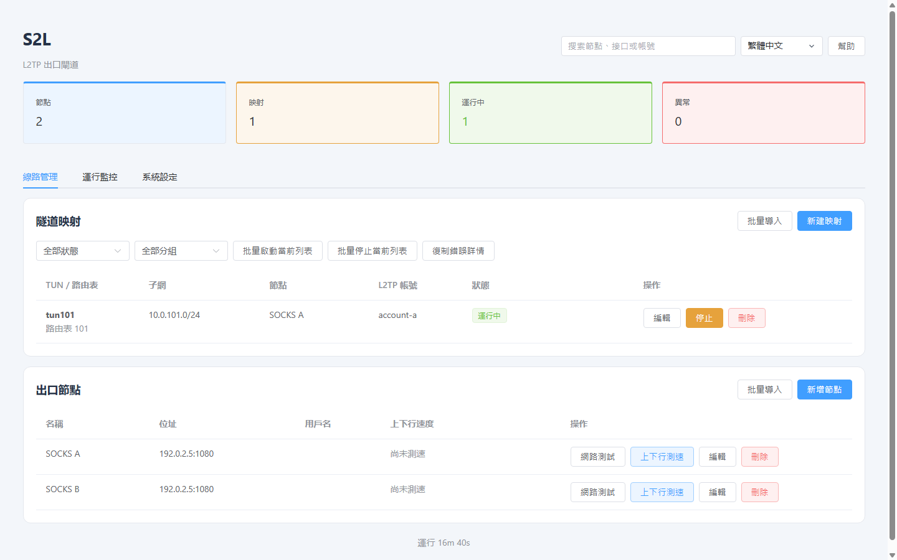

# S2L

[English](README.md) · [繁體中文](README.zh-Hant.md) · [简体中文](README.zh-Hans.md)

**支援網頁管理的 Linux L2TP 閘道，提供固定 SOCKS5 出口、按映射限速及故障自動診斷。**

[](https://github.com/lucaswren/s2l/actions/workflows/ci.yml) · [最新版本](https://github.com/lucaswren/s2l/releases/latest) · [使用討論](https://github.com/lucaswren/s2l/discussions) · [參與貢獻](CONTRIBUTING.md) · [Apache-2.0](LICENSE)



截圖來自隔離測試中的真實介面，位址與帳號皆為範例。[映射與頻寬設定](docs/assets/zh-Hant/showcase-mapping.png) · [斷網自動取證](docs/assets/zh-Hant/showcase-evidence.png) · [運行監控](docs/assets/zh-Hant/showcase-monitoring.png)

- 每台撥號設備使用獨立映射及固定 SOCKS5 出口，一個帳號對應一條 PPP 會話。
- 按映射設定上傳、下載上限，DNS 備用查詢維持同一出口。
- 異常時先保留狀態、日誌與 IPv4 報文頭，減少重啟映射後遺失現場。

S2L 在專用 Linux 主機上執行，由 Go 後端與內嵌 Vue / Element Plus 介面管理 sing-box、L2TP/PPP 與策略路由。每條映射明確選擇 SOCKS5 或本機 WAN 出口，SOCKS5 故障不會回落到 WAN。診斷區分本地轉發、上游與 DNS 故障。

介面分為 **線路管理、運行監控、系統設定** 三個分頁。[運行監控](docs/zh-Hant/operations.md#運行監控) 顯示 PPP 上下行速率、新增與累計錯誤、採樣時效及最近事件。

## 環境與限制

| 項目 | 範圍 |
|---|---|
| 主機 | 專用 Ubuntu/Debian、systemd、root、可達的公網 IPv4，以及核心 TUN/PPP/L2TP 支援 |
| 驗證 | Ubuntu 24.04、Debian 12 amd64 全新安裝虛擬機測試；arm64 交叉建置檢查 |
| 上游 | 授權 SOCKS5 服務，TCP CONNECT 正常，可存取應用及 DoH/TCP DNS 目的地 |
| 用戶端流量 | IPv4；每帳號一條 PPP 會話；拒絕非 DNS UDP；阻擋 PPP IPv6 |
| 語言 | 英文、繁體中文、簡體中文 |

**預設普通 L2TP 不加密。** 選配 L2TP/IPsec 使用 IKEv1 與共用 PSK，須驗證用戶端相容性；管理 HTTPS 與 SOCKS5 不會加密整條隧道路徑。僅用於授權主機與服務，部署前閱讀[接入要求](docs/zh-Hant/clients.md)及[法律說明](docs/zh-Hant/legal.md)。用戶端路由與其他網路介面不在伺服器保護範圍內。

## 安裝與安全

**請在乾淨的專用伺服器上全新安裝 S2L 1.0.11。**

以 root 執行前先審閱腳本。安裝會修改套件、轉送、PPP/L2TP、防火牆與服務，請使用全新專用主機並在維護時段安裝安全更新。新安裝預設採用[人工 APT 維護](docs/zh-Hant/operations.md#系統更新策略)。安裝程式預設取得最新穩定版。

```bash
curl -fsSL https://raw.githubusercontent.com/lucaswren/s2l/main/script/remote_install.sh | sudo bash -s -- --lang zh-Hant
```

僅允許可信管理 IP 存取輸出的 HTTPS TCP 埠。安裝會產生自簽憑證與隨機管理密碼，信任前須透過可信管道核對輸出的 SHA-256 指紋。後端保持監聽 `127.0.0.1:8080`。若需固定管理埠，將 `sudo bash` 改成 `sudo env HTTPS_PORT=8443 bash`；預設從 10000–60000 選取空閒埠。公網 IPv4 偵測需覆寫時使用 `PUBLIC_IP`。

開啟輸出的網址，新增 SOCKS5 節點、建立並啟動映射，再依[用戶端接入與驗收](docs/zh-Hant/clients.md)完成連線。普通 L2TP 使用 UDP 1701；IPsec 強制 NAT-T，使用 UDP 500/4500。安裝選項、防火牆範圍與恢復流程見[操作指南](docs/zh-Hant/operations.md)。

## 升級

透過目前的安裝程式部署後，在維護時段執行：

```bash
curl -fsSL https://raw.githubusercontent.com/lucaswren/s2l/main/script/remote_update.sh | sudo bash
```

升級預設選擇最新穩定版並固定提交，在背景執行，SSH 中斷不會停止任務。進度與結果見 `/var/lib/s2l/cli-update/update.log` 和 `result.json`。若要指定已審閱標籤或提交，將 `sudo bash` 改成 `sudo env S2L_REF=YOUR_REVIEWED_REF bash`。腳本先建置、備份並保留設定；執行中的用戶端須重新連線。操作前閱讀[升級與恢復](docs/zh-Hant/operations.md#升級)，不要重跑安裝程式升級。

## 文件

- [用戶端接入、DNS 與驗收](docs/zh-Hant/clients.md)
- [操作、診斷、備份與解除安裝](docs/zh-Hant/operations.md)
- [架構、設定與開發](docs/zh-Hant/development.md)
- [法律與合規](docs/zh-Hant/legal.md)
- [安全問題回報（英文）](SECURITY.md)

故障自動取證預設開啟，入口為 **系統設定 → 備份與疑難排解**。故障時先匯出現場再重啟映射；自動檢查未發現問題時，可選擇映射並按「記錄當前現場」。[取證限制](docs/zh-Hant/operations.md#故障自動取證)見操作指南；臨時 Debug 為獨立功能。

安裝疑問使用 [Discussions](https://github.com/lucaswren/s2l/discussions)，可重現問題使用 [Issues](https://github.com/lucaswren/s2l/issues/new/choose)。開發檢查見[貢獻指南](CONTRIBUTING.md)，分享文案見[簡短介紹](docs/introduction.md#繁體中文)。

## 致謝

感謝以下開源專案的維護者與貢獻者，讓 S2L 得以實現：

- 隧道與轉送：[sing-box](https://github.com/SagerNet/sing-box)、[xl2tpd](https://github.com/xelerance/xl2tpd)、[PPP](https://github.com/ppp-project/ppp)、[strongSwan](https://www.strongswan.org/)。
- 介面與建置工具：[Vue](https://vuejs.org/)、[Element Plus](https://element-plus.org/)、[Vite](https://vite.dev/)、[Go](https://go.dev/)、[Python](https://www.python.org/)。
- 系統與診斷：[Linux](https://www.kernel.org/)、[Netfilter](https://www.netfilter.org/)、[iproute2](https://wiki.linuxfoundation.org/networking/iproute2)、[tcpdump](https://www.tcpdump.org/)、[systemd](https://systemd.io/)、[Nginx](https://nginx.org/)、[OpenSSL](https://openssl-library.org/)。

元件使用方式與授權參考見[第三方聲明](THIRD_PARTY_NOTICES.md)，前端相依套件的授權原文見[前端授權清單](web/THIRD_PARTY_LICENSES.txt)。致謝不代表上游專案背書或與 S2L 存在關聯。

## 授權

S2L 原創程式碼與文件採用 [Apache-2.0](LICENSE)。參閱 [NOTICE](NOTICE) 與[第三方聲明](THIRD_PARTY_NOTICES.md)，依賴元件保留各自條款。軟體授權不代表取得監管許可。
