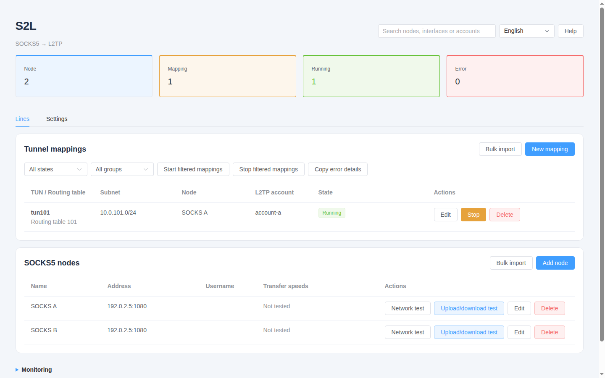
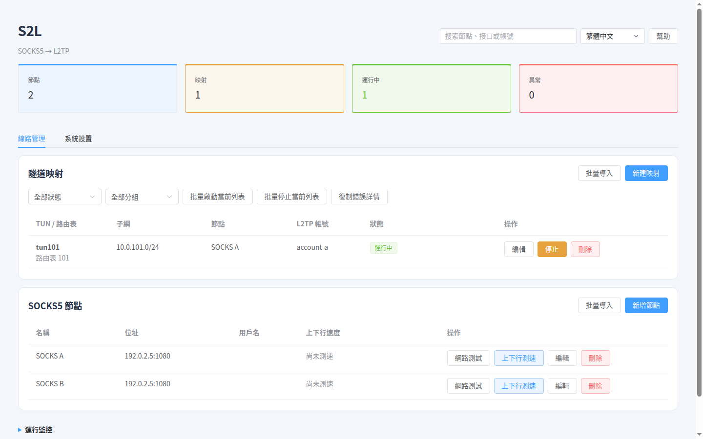
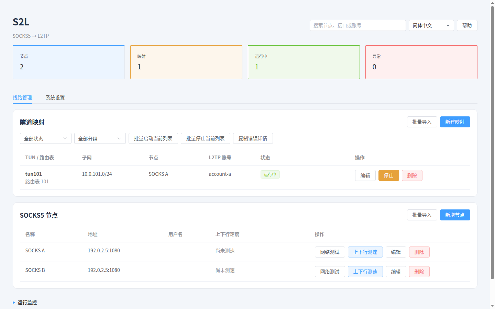

# S2L project introduction

[English](../README.md) · [繁體中文](../README.zh-Hant.md) · [简体中文](../README.zh-Hans.md)

Screenshots use isolated example data and show the matching interface language. They are generated by the [documentation screenshot workflow](https://github.com/lucaswren/s2l/actions/workflows/showcase.yml), not live customer systems or performance benchmarks.

## English

Web-managed L2TP gateway for Linux with fixed SOCKS5 exits, per-mapping bandwidth limits and automatic outage diagnostics.

When a tunnel connects but applications cannot reach the network, S2L separates local forwarding, upstream and DNS checks. Automatic outage evidence retains bounded status history, process logs and short IPv4 header-only captures without restarting mappings or switching exits. Client-side network faults still require separate investigation.

It is intended for operators who already have authorized SOCKS5 upstreams and need manageable L2TP access. Fresh installation is tested on Ubuntu 24.04 and Debian 12; the interface supports English and both Chinese scripts. Plain L2TP is unencrypted by default; optional L2TP/IPsec is available. See the [client guide](en/clients.md) before deploying.

Project: [github.com/lucaswren/s2l](https://github.com/lucaswren/s2l). Stars, practical feedback and reproducible bug reports are welcome.

[Mapping and bandwidth settings](assets/showcase-mapping.png) · [Automatic outage evidence](assets/showcase-evidence.png)

## 繁體中文

支援網頁管理的 Linux L2TP 閘道，提供固定 SOCKS5 出口、按映射限速及故障自動診斷。

針對「能撥號但網頁打不開」的問題，提供本地轉發、上游與 DNS 分層檢查，以及故障狀態、日誌和短時 IPv4 報文頭取證。取證不重啟映射或切換出口，用戶端網路故障仍須另行排查。全新安裝已在 Ubuntu 24.04 與 Debian 12 驗證；預設普通 L2TP 不加密，可選 L2TP/IPsec。

專案：[github.com/lucaswren/s2l](https://github.com/lucaswren/s2l)。歡迎 Star、試用與具體回饋。

[映射與頻寬設定](assets/zh-Hant/showcase-mapping.png) · [故障自動取證](assets/zh-Hant/showcase-evidence.png)

## 简体中文

支持网页管理的 Linux L2TP 网关，提供固定 SOCKS5 出口、按映射限速和故障自动诊断。

遇到“能拨号但网页打不开”的问题，S2L 可以分别检查本地转发、上游连通性和 DNS，并自动保存故障状态、日志及短时 IPv4 报文头抓包，方便保留现场。取证不会重启映射或切换出口，也不能代替客户端网络排查。

适合已有授权 SOCKS5 节点、需要为 L2TP 客户端提供固定出口和基础运维能力的场景。全新安装已在 Ubuntu 24.04 和 Debian 12 验证，提供英文、繁体中文和简体中文界面。默认普通 L2TP 不加密，可选 L2TP/IPsec；部署前请阅读接入要求。

项目地址：[github.com/lucaswren/s2l](https://github.com/lucaswren/s2l)。如果对你有用，欢迎 Star、试用并反馈具体问题。

[映射与带宽设置](assets/zh-Hans/showcase-mapping.png) · [故障自动取证](assets/zh-Hans/showcase-evidence.png)
