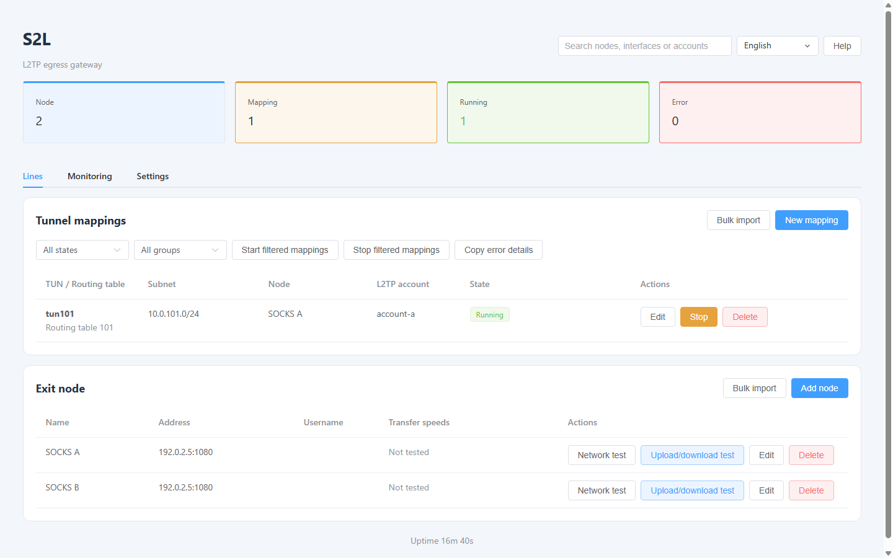
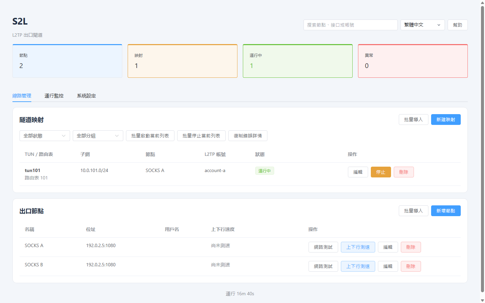
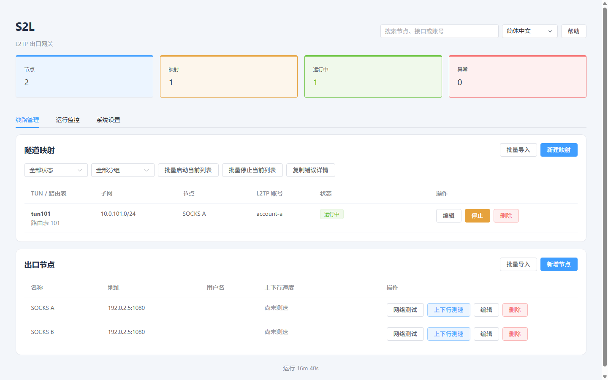

# S2L project introduction

[English](../README.md) · [繁體中文](../README.zh-Hant.md) · [简体中文](../README.zh-Hans.md)

Screenshots use isolated example data and show the matching interface language. They are generated by the [documentation screenshot workflow](https://github.com/lucaswren/s2l/actions/workflows/showcase.yml), not live customer systems or performance benchmarks.

## English

S2L is a web-managed Linux VPN gateway. It accepts L2TP or L2TP/IPsec clients and sends each mapping through an authorized SOCKS5 proxy or a selected Local WAN interface. The web UI configures nodes, credentials, the VPN dial address and per-mapping bandwidth limits.

When a tunnel connects but applications cannot reach the network, S2L separates local forwarding, upstream and DNS checks. Automatic outage evidence retains bounded status history, process logs and short IPv4 header-only captures without restarting mappings or switching exits. Client-side network faults still require separate investigation.

Use Local WAN when the VPN should exit directly from the server. Use SOCKS5 when clients need an existing proxy exit. The Diagnostics and Acceptance panel brings together the dial timeline, node speed tests, mapping forwarding checks and client setup. Fresh installation is tested on Ubuntu 24.04 and Debian 12; the interface supports English and both Chinese scripts. Plain L2TP is unencrypted by default; optional L2TP/IPsec is available. See the [client guide](en/clients.md) before deploying.

Project: [github.com/lucaswren/s2l](https://github.com/lucaswren/s2l). Stars, practical feedback and reproducible bug reports are welcome.

[Mapping and bandwidth settings](assets/showcase-mapping.png) · [Automatic outage evidence](assets/showcase-evidence.png) · [Monitoring](assets/showcase-monitoring.png)

## 繁體中文

S2L 是支援網頁管理的 Linux VPN 閘道，可接入 L2TP 或 L2TP/IPsec 用戶端。每條映射經授權的 SOCKS5 代理或指定的本機 WAN 介面出網。網頁可管理節點、撥號帳密、VPN 撥號位址及映射頻寬。

針對「能撥號但網頁打不開」的問題，提供本地轉發、上游與 DNS 分層檢查，以及故障狀態、日誌和短時 IPv4 報文頭取證。取證不重啟映射或切換出口，用戶端網路故障仍須另行排查。「診斷與驗收」集中提供撥號時間線、節點測速、映射轉送實測及用戶端設定。全新安裝已在 Ubuntu 24.04 與 Debian 12 驗證；預設普通 L2TP 不加密，可選 L2TP/IPsec。

專案：[github.com/lucaswren/s2l](https://github.com/lucaswren/s2l)。歡迎 Star、試用與具體回饋。

[映射與頻寬設定](assets/zh-Hant/showcase-mapping.png) · [故障自動取證](assets/zh-Hant/showcase-evidence.png) · [運行監控](assets/zh-Hant/showcase-monitoring.png)

## 简体中文

S2L 是支持网页管理的 Linux VPN 网关，可以接入 L2TP 或 L2TP/IPsec 客户端。每条映射经授权的 SOCKS5 代理或指定的本机 WAN 网卡出网。网页可管理节点、拨号账号、VPN 拨号地址和映射带宽。

遇到“能拨号但网页打不开”的问题，S2L 可以分别检查本地转发、上游连通性和 DNS，并自动保存故障状态、日志及短时 IPv4 报文头抓包，方便保留现场。取证不会重启映射或切换出口，也不能代替客户端网络排查。

需要服务器直接出网时选择本机 WAN，需要使用现有代理出口时选择 SOCKS5。「诊断与验收」集中提供拨号时间线、节点测速、映射转发实测和客户端设置。全新安装已在 Ubuntu 24.04 和 Debian 12 验证，提供英文、繁体中文和简体中文界面。默认普通 L2TP 不加密，可选 L2TP/IPsec；部署前请阅读接入要求。

项目地址：[github.com/lucaswren/s2l](https://github.com/lucaswren/s2l)。如果对你有用，欢迎 Star、试用并反馈具体问题。

[映射与带宽设置](assets/zh-Hans/showcase-mapping.png) · [故障自动取证](assets/zh-Hans/showcase-evidence.png) · [运行监控](assets/zh-Hans/showcase-monitoring.png)
